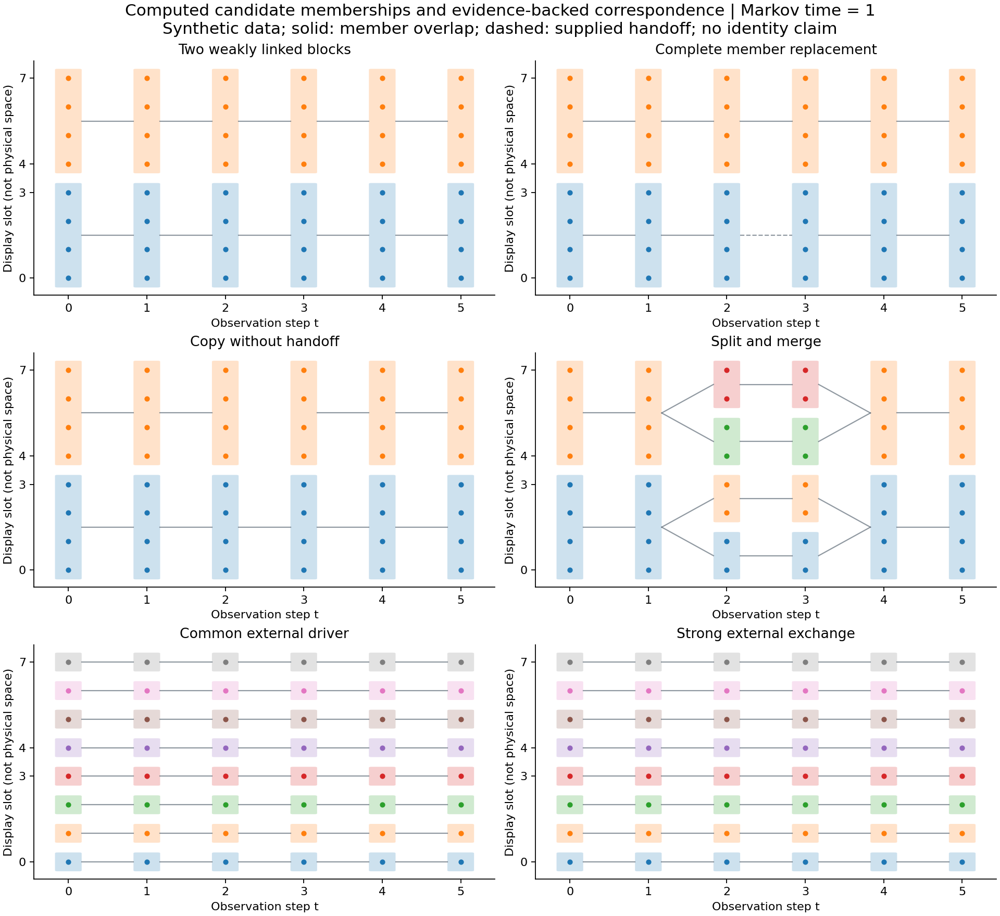
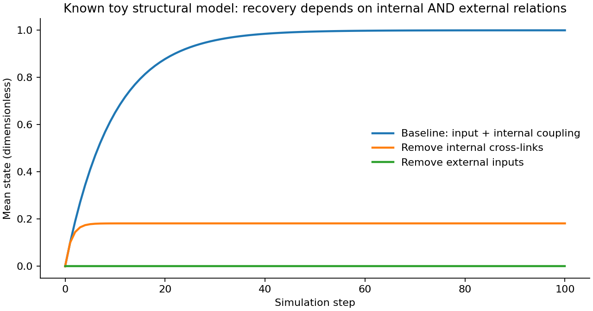
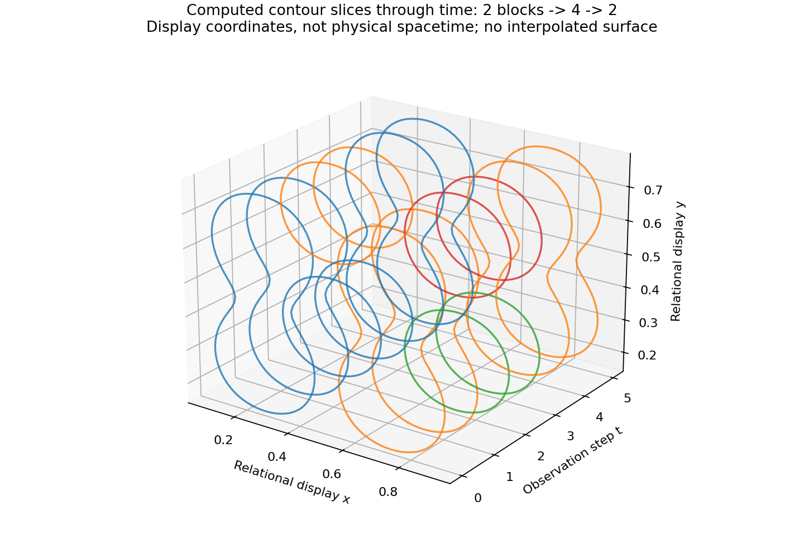

# RIPO — Relational Informational Process Ontology

関係・実現された情報・生成・継承から存在を捉える研究を、**定義、計算、証拠、表示**に分けて検査する独立リポジトリです。

An independent research specification and executable reference model for **Relational Informational Process Ontology**. The implementation extracts model-relative candidates from observations, records evidence-backed correspondence, and renders contours. It does not establish that those candidates are real individuals, alive, conscious or causally autonomous.

## Start here

- [Unified model and six-method comparison](docs/MODEL.md): connects the four ontological questions to individuation, dynamics, lineage and evidence.
- [Precise operational definitions and equations](DEFINITIONS.md): the finite Markov objective, tie policy, contour field and counterexamples.
- [Source provenance and qualification](docs/PROVENANCE.md): recovered v0.2 algorithm versus the new v0.3 input/output profile.
- [Alignment policy](docs/ALIGNMENT.md): RDF/OWL/SHACL/PROV and candidate BFO/CCO correspondences.
- [Computed results](results/experiment.json), [record export](results/hypotheses.jsonld), [test report](results/tests.txt), [RDF check](results/rdf-validation.json).
- [Offline viewer](viewer.html): download/clone and open locally; GitHub's file view does not run the app. No hosting or website release is configured.
- [Companion article and source review](https://github.com/com-junkawasaki/webmaster/pull/27). Website delivery is tracked separately in JUN-653.

## Reproduce

Use Python **3.12** and an external scratch virtual environment. Activate it, then run from this repository root:

```sh
python -m pip install --only-binary=:all: -r requirements.txt
OPENBLAS_NUM_THREADS=1 python -m unittest discover -v
OPENBLAS_NUM_THREADS=1 python engine.py
python build.py
python scripts/validate_rdf.py
node test_viewer.cjs
```

The 16 recovered numeric tests and ten snapshot-interface tests exercise the model, probability conservation, permutation/weight-scale invariance, copy versus handoff, split/merge, missing observations and refusal of unsupported inputs. Twelve additional market-study controls cover allocation, reserves, eligibility and evidence boundaries (38 total). The DOM shim checks 720 scenario/time/scale/layout/width states and is not pixel/layout QA. All runtime computation, exports and the viewer operate without network access after dependency installation. Python is a scientific reference, not a Kotoba native qualification gate. No JVM/nbb path or CI workflow is included.

## Supply snapshots

### Awai resource-matching study (JUN-727)

[Japanese research report](docs/AWAI-MARKET-20261031.md) compares published Uber
observations, Airbnb's reported online experiment and static counterfactuals,
an anonymized short Awai snapshot, and a separately typed synthetic allocation
model. The study invokes the existing RIPO extractor on an explicit undirected
exchange fixture; job/provider eligibility remains directed and separate.

```sh
OPENBLAS_NUM_THREADS=1 python market.py
```

Inputs live in `data/market-evidence.json`, `data/awai-snapshot-20261031.json` and
`examples/awai-market.json`; output is `results/awai-market/`. Synthetic value
points and reservation ratios are not actual revenue, GPU utilization, job
completion or Awai improvement. No real jobs are dispatched and no host
permissions are granted. The new controls are included in unittest discovery.

### Original snapshot CLI

```sh
python ripo.py fixture --scenario replacement --output examples/replacement.json
python ripo.py extract examples/replacement.json --tau 1 --output results/replacement-profile.json
```

The explicit input format is `ripo.snapshots.v1`: `directed:false`, `signed:false`, `arity:2`, one `relation_kind` (`exchange`, `similarity`, `correlation`) and a nonempty `frames` array. Each frame contains `step`, unique `ids`, a square symmetric nonnegative `adjacency` and explicit `handoffs`. See the [complete example](examples/replacement.json).

Snapshots contain at most eight observations. Unsupported signed/directed/higher-arity input fails closed; it is not converted to a clique or another graph. Steps are ordered observations, not elapsed seconds. Physical observation windows and construction from raw events remain study-specific. A gap produces `observation_gap_unresolved`. Observation IDs and supplied handoffs are input assumptions; this program does not authenticate them. The generated common-driver fixture mirrors its correlation upper triangle to eliminate floating-point asymmetry; this is an explicit fixture construction step. External asymmetric input is still rejected. Inputs whose totals or transition kernels exceed finite solver arithmetic return an input error.

Output binds input SHA-256, model profile and Markov time to a run SHA-256. These are **canonical JSON hashes, not IPLD CIDs**. The planned Kotoba adapter would use verified IPLD/DAG-CBOR/CID blocks as authority and RDF/Datom indexes as explicit projections. That integration is not implemented here.

## Reproduced synthetic results

Six fixtures × six snapshots × five Markov resolutions yield 180 finite optimizations. Each eight-node snapshot has 4,140 possible partitions. An additional 36 modularity controls, six zero-mechanism graphs and 20 seeded weight perturbations are evaluated.

| Fixture | Blocks at observation steps 0–5, tau=1 | Interpretation |
|---|---|---|
| Weakly linked groups | 2,2,2,2,2,2 | Selected-scale structural/diffusion candidate |
| All members replaced | 2,2,2,2,2,2 | Correspondence depends on supplied handoff evidence |
| Isomorphic copy without handoff | 2,2,2,2,2,2 | The new group's lineage remains unresolved |
| Split / merge | 2,2,4,4,2,2 | Many-to-many correspondence, not owl:sameAs |
| Common external driver | 8,8,8,8,8,8 | Correlation graph differs from the specified causal mechanism |
| Strong external exchange | 8,8,8,8,8,8 | Does not recover the prespecified internal/environment distinction |



For a complete graph, the fixed-time objective prefers singletons, while modularity prefers one group. A one-block partition has zero centered stability. **Markov Stability alone cannot define existence.** Membership, numerical robustness, statistical uncertainty, causal maintenance and geometric contours are separate quantities.

A separate two-variable specified structural model runs baseline, removed internal coupling and removed external input conditions for 100 steps. Their analytic equilibria are 1, 2/11 and 0. This is a toy recovery model with unequal intervention magnitudes, not an autonomy ranking or empirical biology.





The last figure stacks contour slices at observation steps; its axes are display coordinates and time index, not physical spacetime or a reconstructed material surface.

## What remains open

SBM comparison, coherent sets, Markov blankets, directed/typed hypergraphs, overlapping membership, empirical data, predictive holdout evaluation, calibrated uncertainty and matched causal interventions remain research work. RDF parsing and bounded SHACL conformance are tested; OWL consistency, BFO/CCO equivalence and Inc correspondence proofs are not. A Git hash, signature or CID would not certify a measurement's truth or continuity of consciousness.

Generated artifacts record the actual local environment. Source reconstruction and local tests do not establish byte-for-byte reproduction of the earlier private archive; see [provenance](docs/PROVENANCE.md). No open-source license has been selected in this repository; public source visibility alone grants no license beyond the hosting platform's terms.
