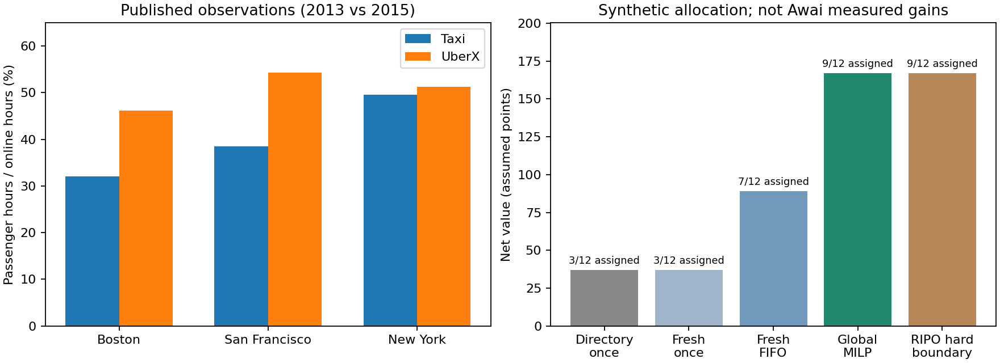

# Awai Network：未活用資源の摩擦を情報・割当モデルで調べる

2026-10-31 JST / JUN-727、関連 AWAI-124・AWAI-126 / scientific Python reference

## 結果の読み方

Airbnb/Uberは、資源を一覧化するだけでなく、利用可能性の更新、相互の受入条件、探索負担、複数者の割当を改善した。ただし全資源を100%稼働させた証拠ではない。本研究は以下を別々に記録する。

| 証拠 | 今回できたこと | 言えないこと |
|---|---|---|
| 公開観測値 | Uber論文の表の転記と差分再計算 | 配車アルゴリズム単独の因果効果 |
| 報告された介入実験 | AirbnbのオンラインA/B結果を一次論文で確認 | 非公開の個票・予約件数から効果や標準誤差を独立再推定 |
| 公開モデル推定 | Airbnbの反実仮想の表を転記・再計算 | 実際の導入前後の差 |
| Awai実測の記述統計 | 先行の匿名5Mac短時間snapshotを再集計 | 提供可能capacity、代表7日、実jobの改善率 |
| 合成計算 | 固定資源・需要で5方式、100条件の感度比較 | Awaiの実需要・採算・実行品質・社会全体の厚生 |

入力は [market-evidence.json](../data/market-evidence.json)、[匿名snapshot](../data/awai-snapshot-20261031.json)、[合成fixture](../examples/awai-market.json)。計算出力は [result.json](../results/awai-market/result.json)。原資料の取得日・SHA-256・表番号を保存する。PDF全文はrepoに転載しない。SHA-256はCIDでも測定の真正性証明でもない。



## Uber：時間・場所の不一致と配車を減らす

[Cramer & Krueger (2016), Table 1 p12](https://www.nber.org/system/files/working_papers/w22083/w22083.pdf) の集計比率Fを使う。分母は運転手の勤務時間合計、分子は乗客を乗せた時間合計。運転手別比率の単純平均f、車両の24時間稼働率、走行距離率とは異なる。

| 都市 | Taxi F | UberX F | 差（percentage points） | 相対差 | 乗客時間100hに必要な勤務時間：Taxi→Uber |
|---|---:|---:|---:|---:|---:|
| Boston | 32.0% | 46.1% | +14.1pp | +44.06% | 312.50→216.92h |
| San Francisco | 38.5% | 54.3% | +15.8pp | +41.04% | 259.74→184.16h |
| New York | 49.5% | 51.2% | +1.7pp | +3.43% | 202.02→195.31h |

計算は `relative=100*(Uber/Taxi-1)`、`hours=100/(F/100)`。NAの都市を0にせず比較から除外。Taxiは2013年、Uberは2015年中心で対象期間や運転手が異なるため、同一集団の改善やランダム化効果とは呼ばない。著者は配車技術、規模、規制、柔軟な供給と価格を候補要因に挙げるが、各要因の寄与率は未識別。Uber提供データと著者の過去の受託関係も出典に記録した。

現在の[Uber公式説明](https://www.uber.com/us/en/marketplace/matching/)も、最近接への即時配車から、数秒の複数要求をまとめて平均待ち時間を考慮する配車を説明する。この現在の機構説明が2016年の観測差の原因を証明するわけではない。Awaiでの対応は、CPU仕事を先にGPUノードへ詰めず、GPU専用仕事も見て一括割当すること。

## Airbnb：在庫の鮮度、相手の受入条件、注意の配分

### 実際のオンライン実験として報告された結果

[Haldar et al. (2024), Learning to Rank for Maps at Airbnb, §3.1](https://arxiv.org/html/2407.00091v1#S3.SS1) は、地図上の候補を予約可能性に応じて選別するBookability FilterのオンラインA/Bを報告する。最終実験はcontrol/treatment各3,400万人の検索者。

| 指標 | 報告された相対変化 |
|---|---:|
| キャンセルされなかった予約 | +1.9% |
| 滞在後5つ星の旅行 | +2.0% |
| 予約した宿を見つけるまでに見た結果数 | -16% |
| 同じくクリックした結果数 | -6.8% |

主要指標のp値は10^-5未満と著者が報告。1.9は稼働率のpercentage pointsではない。生の予約件数・個票・標準誤差が公開表にないため、今回独立に再推定していない。企業著者による報告であり、そのままAwaiの期待効果に移植しない。異なる実験の改善率を足し算しない。

### 古い市場を用いた静的モデル比較

[Fradkin, Search, Matching, and the Role of Digital Marketplace Design in Enabling Trade, Table 6 p51](https://andreyfradkin.com/assets/SearchMatchingEfficiency.pdf) は、主にChicagoの2013-09〜2014-09の探索を使う。以下は固定した探索条件におけるモデル予測であり、実測A/Bではない。

| モデル比較 | 先行→後続 | 差 | 相対差 |
|---|---:|---:|---:|
| ランダム候補→利用可能な候補だけ：初回問合せ受入／全検索者 | 7.7→18.2% | +10.5pp | +136.36% |
| ランダム候補→当時の検索機能一式：同上 | 7.7→24.3% | +16.6pp | +215.58% |
| ランダム候補→検索機能一式：拒否／問合せ者 | 77.5→31.8% | -45.7pp | -58.97% |
| 個人化＋利用可能性→受入確率も考慮：受入／全検索者 | 30.6→33.6% | +3.0pp | +9.80% |

約59%は「検索機能がなければ」というモデルとの拒否率差で、空室カレンダー単独の導入前後差ではない。全体観測の42%拒否とモデル表の31.8%を混ぜない。Acceptedは問合せの受入で、宿泊完了や予約全体と同義ではない。固定探索条件・静的評価なので、予約による後続在庫減少、価格、長期供給の反応は含まない。

### 供給の柔軟性と厚生の限界

[Farronato & Fradkin, AER 2022 pp1783–1785](https://andreyfradkin.com/assets/airbnb_welfare_paper.pdf) は2014年の上位10都市について、消費者余剰3.05億ドル、peer host余剰1.12億ドルを構造モデルで推定する。Airbnb room-night当たり約70/26ドルであり、70ドルにはホテル客への価格低下利益も含まれる。旧working paperの約41ドルと混ぜない。売上・利益の実測や、住民・住宅・労働市場・長期変化まで含む完全な社会厚生ではない。

Awaiも、ノード稼働率の上昇と、利用者・提供者・第三者を含む価値の改善を分ける。電力、転送、機器寿命、foreground遅延、運用負担を未計測のまま「社会的利益」と合算しない。

## RIPOをどう使ったか

既存の `ripo.extract` を実際に呼び、別に宣言した5点の無向・非負の**合成交換量**から、`[sim-gpu-a, sim-cpu-a]`、`[sim-gpu-b, sim-cpu-b]` と孤立した`sim-stale`を得た。tau=1は解像度で、600秒の仕事窓とは無関係。

仕事→提供者は役割・方向・権限を持つため、既存の無向抽出器へ投影していない。別の型付き割当モデルに保持した。交換のまとまりは候補説明であり、同意、実行資格、同一性、障害領域、優先権を生成しない。今回はクラスタが性能を上げたとの結果も出ていない。

反例として、片方のGPUが停止し、その群からGPU仕事が1件だけ来る条件を計算した。群を越えた適格割当なら1件／37点、RIPOの群を強制境界にすると0件／0点だった。通常fixtureでは両方式とも9件／167点。**関係のまとまりを閉鎖的な組織境界にしてはならない**という有限反例で、一般的な組織理論の証明ではない。

## Awai向けの明示的な数理モデル

各仕事jを提供者nへ置くかを x_jn ∈ {0,1} とする。

```
maximize  Σ_jn (v_j − c_jn) x_jn
subject to
  Σ_n x_jn ≤ 1                                仕事は一回だけ
  Σ_j d_jr x_jn ≤ C_nr (1 − h_nr)             資源rごとの余力を残す
  x_jn ≤ E_jn                                 適合・鮮度・資格・同意・期限
```

- 資源rはCPU logical cores、RAM GiB、適格GPU slots、storageの同時peak GiB、network予約Mbps。換算不能な量を一つの稼働率へ足さない。
- v/cは**仮定した価値・費用ポイント**。価格・電力・時間の実測値ではない。原価や成功率の未測定値を外挿しない。
- 600秒の同時予約窓のみ。仕事の動的到着、checkpoint、先取、モデルload/KV、GPU共有メモリ、同一APFS pool、N-1複製、修復、リンク共有、バッテリー、p95期限の実装は含まない。
- GPU slotsはfixtureが適格と仮定した離散単位で、実端末のGPU数やbusyではない。
- hはfixtureでCPU/RAM/network25%、storage20%、GPU0%。GPUは1slotずつの仮想ノードであり、瞬時返却やGPU余力を保証していない。
- `consent`は合成入力のeligibilityだけ。実appの操作別同意、Botのtool権限やhost強制を代替しない。
- MILPの最適性は、この有限モデルと入力に条件づけられる。社会全体の最適性でも制約の真実性でもない。

## 合成実験の計測値

固定5提供者（1件は古い情報）、12仕事：CPU4、GPU4、storage2、private1、未対応runtime1。実測と同じN1等のラベルは使わない。全方式で同じ最終eligibility/容量検査を行い、不正な実行はモデル上も受け付けない。

| 方式 | 仮想割当数／12 | 純価値ポイント | 何を変えたか |
|---|---:|---:|---|
| directory_once | 3 | 37 | 生の先頭候補へ一度だけ試みる |
| fresh_once | 3 | 37 | 鮮度・資格・受入条件等で候補を絞り一度だけ試みる |
| fresh_fifo | 7 | 89 | 上記と同じ情報で、容量拒否後は次の候補を試す |
| optimized | 9 | 167 | 同じ候補・余力・費用で一括MILP |
| ripo_hard_boundary | 9 | 167 | MILPに所属群内だけの制約を追加 |

鮮度等の改善単独では、このfixtureの最終成果は増えなかった。directory→FIFOの差を鮮度単独の因果効果と呼ばない。CPU仕事が先に来る順序なので、FIFOはGPUノードを先に埋めGPU仕事を取り逃す。主結果89→167点（+87.64%）はその順序に強く依存する。

順序seed 0–19をCPU/RAM/network余力5水準と交差した100条件を、FIFO/MILPの両方で計算した。これは固定fixtureの感度分析で、母集団の信頼区間ではない。

| CPU/RAM/network余力 | FIFO純価値：20順序平均［最小,最大］ | MILP純価値：全順序同値 |
|---:|---:|---:|
| 0% | 151.25 [122,163] | 169 |
| 10% | 144.85 [122,163] | 169 |
| 25% | 147.00 [122,163] | 167 |
| 40% | 99.20 [68,132] | 138 |
| 60% | 57.55 [42,71] | 71 |

25%余力の順序平均では差は+13.61%。主結果の大きな差だけを予測に使わない。余力0%の高い点数も、foregroundや復旧を評価しないモデル内の値で、推奨設定ではない。

最適化の基準条件はCPU 20/24 offered cores（83.33%）、RAM 44/60GiB（73.33%）、GPU 2/2予約slots、storage 136/320GiB peak（42.5%）、network 85/300Mbps予約（28.33%）。実際の稼働時間・I/O・goodputは測っていない。CPUの物理設定32coresを分母にすれば62.5%。分母を変えて改善に見せない。

明示的な需要ゼロの負対照は割当0、割当率null。欠測を「需要ゼロ」とは解釈しない。未対応runtime、同意拒否、全memory予備、非正の純価値等も拒否を検査する。

## 実端末で分かったこと／まだ分からないこと

先行AWAI-124観測は2026-10-31の匿名5Mac、50 logical cores、搭載RAM112GiB。3件のData volumeが90%以上だった。別々の短時間CPUサンプルから `Σ cores*(1-busy)` を算術集計すると31.465 logical-core相当になるが、**同時に空いていた提供capacityではない**。異機種・P/E coreを混ぜた値は処理性能の同等量でもない。

GPU busy、電力、モデル別実行資格、所有者の提供時間、成果受入を伴うjob履歴がないため、実job改善率・利益・利用可能GPU/RAMをnullとした。GPU100%や端末効率+87%などへの言い換えは禁止。サンプルの観測と公開資料の再計算が、今回の実データを使った範囲である。

## 次の実証に必要な記録と介入

AWAI-124（測定）とAWAI-126（dry-run配置）へ渡す。新しい常駐agentやschedulerは本研究から配備していない。

1. 物理pool/VM親子、資源単位、failure domain、owner提供時間、foreground保護条件を確認する。観測をoffered/qualified/unknownと区別し、TTL満了を実プロセス解放とみなさない。
2. Murakumo/Yataverseのownerに必要とされた仕事だけを収集。メタデータはjob ID、要求資源・runtime/品質/期限、承認状態、候補集合、鮮度、割当/拒否理由、queue/start/end、実転送量・電力、成果の受入/取消。本文やpromptを公開しない。
3. 同一の記録をFIFOとMILPへshadow replayし、当時の実行結果と未実行候補の未知の結果を分ける。未実行jobの反実仮想の品質/速度は、モデルなしに埋めない。
4. 実行資格とhost強制が揃ってから、同一workloadの時間blockをランダム化するswitchbackや独立poolの比較を設計する。共有容量の競合で個別job A/Bが干渉し得る。carryover・warm cache・既存queue・曜日/時刻を記録し、washout/持越処理を決める。必要sample数は実測分散と事前に決める最小検出効果から計算し、今回捏造しない。
5. 指標は受入成果/提供core・GiB時間、queue/e2e p95、原価・energy/受入job、返却時間、foreground非劣化、失敗・復旧・提供者負担。需要増加/予約の移転/新規の有用成果も区別する。

一般の中古品なら品質証拠・配送・返品、人なら本人の選好・休息・技能・責任が追加の条件となる。このコードはそれらの実証や労務配分の正当性を扱っていない。熱力学やホログラフィック原理から数値の効果率を導かず、観測可能な摩擦と対照で検証する。

## 再現

既存READMEどおりの外部Python3.12 venv（requirements.txt）を使う。新規依存・CI・Kotoba runtime・server/APIは追加しない。

```sh
OPENBLAS_NUM_THREADS=1 python -m unittest discover -v
OPENBLAS_NUM_THREADS=1 python market.py
```

本追加はJUN-727のDraft PRとしてレビューする。mainへのmerge・記事の公開・本番schedulerへの導入は別の作業である。
